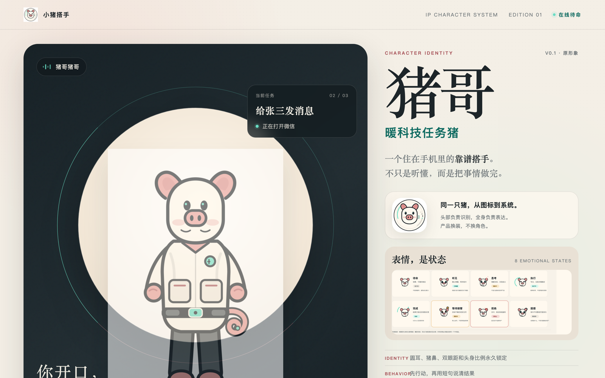
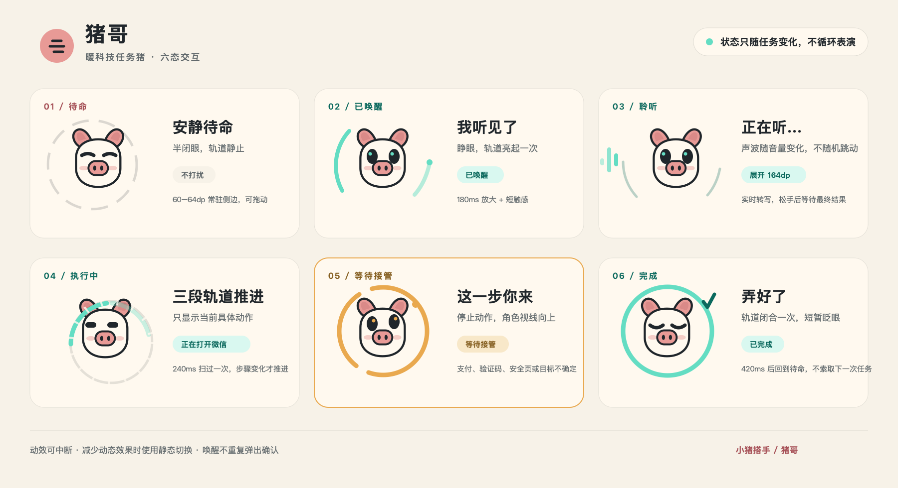
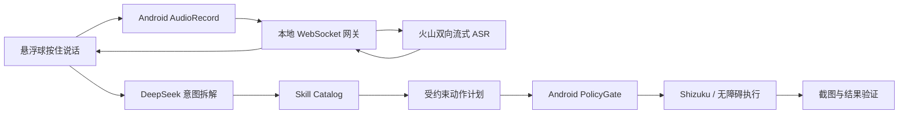

# 小猪搭手

> **实验分支提示：** 此分支保存 2026-10-23 的微信截图 OCR 自动回复实验，未合并到
> `main`，不应部署到日常手机。实验已因微信界面 OCR 不稳定而暂停，原因和已跑通部分见
> [实验失败记录](docs/superpowers/experiments/2026-10-23-wechat-explicit-reply-failure.md)。

<p align="center">
  
</p>

<p align="center">
  <strong>你开口，我来做。</strong><br />
  一个看得见手机屏幕、听得懂自然语言、能真正动手完成任务的 Android 个人 Agent。
</p>

<p align="center">
  <a href="https://github.com/zhixiang-luo/xiaozhu-dashou/actions/workflows/ci.yml"></a>
  <a href="https://github.com/zhixiang-luo/xiaozhu-dashou/actions/workflows/android.yml"></a>
  <a href="LICENSE"></a>
  
</p>

> **项目状态：v0.1 Developer Edition。** 这是一个面向专用 Android 设备的实验性
> 个人 Agent，不是已经可以直接安装到普通用户主力手机上的消费级产品。

## 为什么做小猪搭手

桌面 Agent 已经可以读屏幕、写代码、操作浏览器。但手机上最日常的事情仍然需要人一步步
点：打开微信、找到会话、输入一句话、切到地图、搜索地点、设提醒。

我在电脑上用 Codex，可以让它读文件、开网页、跑测试，真正把事情做完；但拿起手机，
这种“说一句就有人搭手”的能力突然消失了。手机有最多生活入口，却仍然需要人跨过几十个
App、几百个按钮。

小猪搭手想补上的，是桌面 Agent 到手机之间的最后十厘米。

小猪搭手想验证另一条路径：

```text
“帮我到文件传输助手里面发一句：测试成功了”
                    ↓
             实时中文语音识别
                    ↓
             DeepSeek 意图拆解
                    ↓
       文件传输助手 + 消息正文“测试成功了”
                    ↓
     打开微信 → 进入会话 → 输入 → 发送
```

它不是另一个聊天机器人，而是一个把“语言”变成“手机上的动作”的开源实验。

### 它最终想成为什么

不是另一个更花哨的语音助手，而是一个持续存在、理解上下文、可被安全委派的个人数字代理：

- **现在**：你把一句明确的话说出来，它跨 App 完成任务；
- **下一步**：它知道“刚才那个”“这里”“晚一点”具体指什么；
- **再远一点**：它能在你授权范围内主动搭手，例如整理待回复消息、准备路线、生成待办；
- **终极目标**：让人的意图延伸到数字世界的每个角落，同时把支付、验证码和账号安全牢牢
  留在人手里。

猪哥不是接管你生活的黑盒，而是你愿意把重复操作交给它、又随时能看见和叫停它的伙伴。

完整故事：[为什么做一只会搭手的小猪](STORY.md)。

<p align="center">
  
</p>

## 当前能力

| 能力 | 状态 | 说明 |
| --- | --- | --- |
| 中文按住说话 | 可用 | 悬浮球长按录音、触觉反馈、实时字幕 |
| 火山双向流式 ASR | 可用 | 16 kHz PCM，边听边识别，松手后提交累计文本 |
| DeepSeek 意图拆解 | 可用 | 把自然语言转成受 Schema 约束的技能调用 |
| 系统设置 | 可用 | 语音打开设置已在 Redmi K60 真机验证 |
| 系统日历 | 可用 | 查询、创建、修改和删除个人日程；唯一匹配并回读验证 |
| 本地背景记忆 | Beta | SQLite 保存近期任务、联系人别名和偏好，规划前注入未来日历与近期上下文 |
| 微信文件传输助手 | Beta | 已录制坐标和验证点，支持自然语言指定消息正文 |
| 微信任意联系人 | 计划中 | 需要唯一收件人、搜索页和视觉验证校准 |
| 网易云音乐 / 高德 | 计划中 | 已有技能清单，等待真机回放 |
| 常驻唤醒 / 正式 TTS | 计划中 | 当前使用悬浮球入口和系统中文转写体验 |

## 架构



- **语音与意图分离**：ASR 只负责听清，DeepSeek 只负责拆解意图。
- **模型不能直接点屏幕**：模型只能选择已注册技能并填写参数。
- **技能版本化**：每个 App 流程由 `skills/**/manifest.yaml` 描述。
- **先补背景再规划**：`ContextBuilder` 在本机汇总前台页面、未来日历、近期任务、
  联系人别名和偏好，只把紧凑结构化上下文交给规划模型。
- **手机负责最终授权**：所有动作经过本地风险策略、任务代次和页面检查。
- **可替换模型**：语音、意图和视觉能力使用独立适配器，不绑定单一供应商。

## 安全边界

小猪搭手优先防止错误操作，而不是追求“什么都能自动化”。

- 普通消息只有在收件人和页面都明确时才允许自动发送。
- 账号登录、支付、转账、红包、验证码、密码、银行卡和身份验证必须由本人完成。
- 同名联系人、可疑页面和未校准 App 版本会停止或请求澄清。
- API Key 只存在于服务端 `.env`，不会进入 Android APK。
- 音频和转写正文不写入服务端日志。
- 出现歧义时宁可停下来，也不盲点固定坐标。
- 微信自动发送在公开版本默认关闭，只能由专用开发者设备显式开启。

完整说明见 [安全与隐私](docs/05-security-privacy.md)。

### 已知限制

- 微信 8.0.79 不提供可用 UI 树，当前技能依赖校准坐标；即使重启微信和校验前台包名，
  仍未实现发送前的 OCR 会话标题验证。
- 因此微信发送仍标记为 Beta，只应在专用测试设备启用。
- 设备 Token 是本地开发认证，不是面向互联网的产品级账号体系。
- DeepSeek 会接收用户文字，火山会接收语音；默认部署仅监听本机回环地址。
- 日历需要 `READ_CALENDAR` / `WRITE_CALENDAR`。重复日程、零个匹配或多个匹配都会停止，
  首版不邀请他人，也不批量修改或删除。
- 联系人别名和偏好已有本地存储接口，但首版还没有独立的查看、编辑和删除界面。

## 5 分钟开始

### 依赖

- Node.js 22+
- pnpm 11+
- JDK 17
- Android SDK 35 / Build Tools 36
- 已安装 Shizuku 的 Android 11+ 测试设备

### 本地运行

```bash
git clone https://github.com/zhixiang-luo/xiaozhu-dashou.git
cd xiaozhu-dashou
corepack enable
pnpm install
cp .env.example .env
pnpm check
```

在 `.env` 中配置：

```dotenv
DEVICE_TOKEN=replace-with-a-random-development-token
ASSISTANT_TIME_ZONE=Asia/Shanghai
VOLCENGINE_ASR_API_KEY=your_volcengine_key
VOLCENGINE_ASR_RESOURCE_ID=volc.seedasr.sauc.duration
DEEPSEEK_API_KEY=your_deepseek_key
DEEPSEEK_BASE_URL=https://api.deepseek.com
DEEPSEEK_MODEL=deepseek-chat
ALLOW_WECHAT_AUTOSEND=false
```

只有在你确认手机是专用测试设备、微信文件传输助手位置已校准时，才可把
`ALLOW_WECHAT_AUTOSEND` 改成 `true`。默认关闭是为了避免坐标失效时误发到错误会话。

构建 Android 时通过环境变量或 Gradle 参数传入同一个 Token：

```bash
DEVICE_TOKEN=replace-with-a-random-development-token ./gradlew :app:assembleDebug
# 或：./gradlew :app:assembleDebug -PDEVICE_TOKEN=replace-with-a-random-development-token
```

启动编排服务：

```bash
pnpm --filter @personal-jarvis/orchestrator start
```

连接手机并建立回环端口：

```bash
adb reverse tcp:4100 tcp:4100
```

构建并安装 Android App：

```bash
cd android
JAVA_HOME=/opt/homebrew/opt/openjdk@17 \
ANDROID_HOME=/opt/homebrew/share/android-commandlinetools \
./gradlew :app:testDebugUnitTest :app:assembleDebug
adb install -r app/build/outputs/apk/debug/app-debug.apk
```

设备配置和权限步骤见 [专用设备配置](docs/11-device-setup.md)。

Debug APK 还包含一个只存在于调试包、用于真机回归的显式文本入口。它会跳过语音转写，
但仍经过同一套 `ContextBuilder`、DeepSeek、动作校验和本地执行器；正式发布包不包含
该入口：

```bash
adb shell am broadcast \
  -a com.personaljarvis.DEBUG_RUN_TASK \
  -n com.personaljarvis/.debug.SkillTraceReceiver \
  --es instruction 我明天下午有什么安排
```

## 仓库结构

```text
xiaozhu-dashou/
├── android/                  Kotlin Android 客户端、语音和执行器
├── services/orchestrator/    Fastify 编排、火山语音网关、DeepSeek 规划
├── packages/contracts/       Android 与服务端共享协议
├── packages/skills/          技能 manifest 解析与校验
├── skills/                   微信、音乐、地图和跨 App 技能
├── design/                   品牌、角色、表情和动效视觉资产
├── docs/                     产品、架构、ADR、安全和验收记录
└── .github/                  CI、Issue Forms、CODEOWNERS 和 Dependabot
```

## 扩展技能

一个 App 技能由确定性的 manifest 描述，不要求所有开发者直接修改 Android 通用循环：

- [App 技能架构](docs/14-app-skill-architecture.md)
- [新增 App 技能](docs/guides/adding-app-skill.md)
- [录制 App 技能](docs/guides/recording-app-skill.md)
- [新增模型供应商](docs/guides/adding-model-provider.md)

新增模型必须经过结构校验、超时、错误映射和安全评测；新增 App 技能必须包含唯一目标、
成功验证、失败降级和支持版本。

## 参与开发

项目使用 MIT License 和 DCO。提交前请阅读：

- [贡献指南](CONTRIBUTING.md)
- [行为准则](CODE_OF_CONDUCT.md)
- [安全策略](SECURITY.md)
- [当前交接状态](docs/HANDOFF.md)
- [完整文档索引](docs/README.md)

欢迎提交设备兼容性报告、技能 manifest、模型适配器和安全测试。不要在 Issue 或 PR 中
上传真实聊天、录音、联系人、手机号、API Key 或支付信息。

## 路线图

近期重点是把“看得见、做得对、能验证”做扎实：更多微信联系人、网易云音乐、高德、
跨 App 参数传递、视觉定位和失败恢复。完整计划见 [ROADMAP.md](ROADMAP.md)。

## License

代码和文档采用 [MIT License](LICENSE)。官方名称、Logo 和“猪哥”角色视觉的品牌边界
见 [TRADEMARK.md](TRADEMARK.md)。
